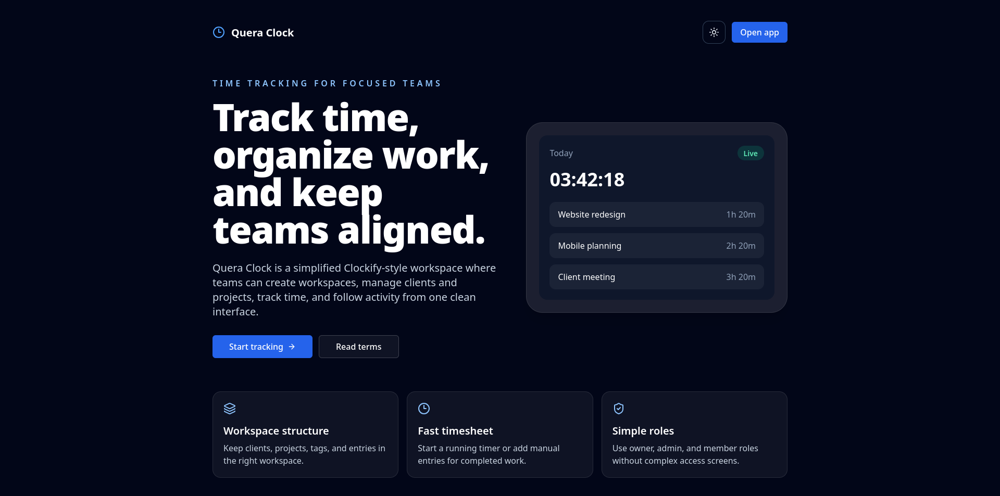

# Quera Clock

## Preview



<div dir="rtl">
Quera Clock یک ابزار ثبت و مدیریت زمان است که در دوره «جامپ بک‌اند با جنگو» کوئرا توسعه داده شده است.

این پروژه شامل دو بخش اصلی است:

* `backend/`: بک‌اند پروژه با Django و Django REST Framework
* `frontend/`: رابط کاربری پروژه با React و TypeScript

ساختار کلی:

```text
quera-clock/
├── backend/
└── frontend/
```

## راهنما

هر بخش README مستقل خود را دارد:

* برای اجرای بک‌اند و آشنایی با ساختار API به `backend/README.md` مراجعه کنید.
* برای اجرای فرانت‌اند و تنظیمات مربوط به آن به `frontend/README.md` مراجعه کنید.

فرانت‌اند این پروژه توسط کوئرا (`quera.org`) و در قالب دوره «جامپ بک‌اند با جنگو» ارائه شده است و این مخزن نسخه یکپارچه‌شده‌ی بک‌اند و فرانت‌اند پروژه را نگهداری می‌کند.
</div>